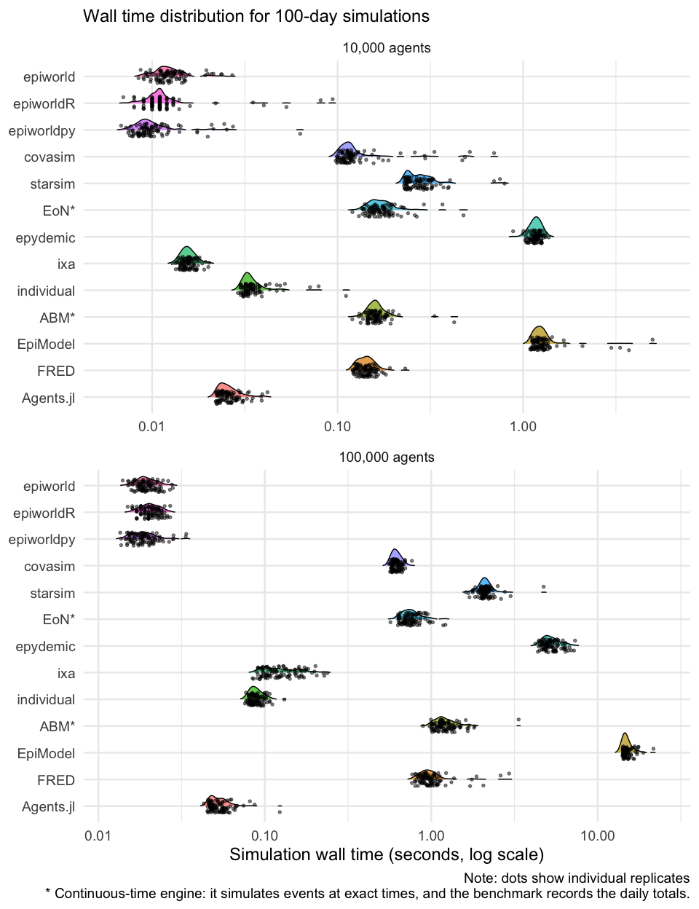

# Scenario 05: SEIRH baseline with network uncertainty

2026-10-23

- [Model](#model)
- [Engine notes](#engine-notes)
- [Results](#results)
  - [Simulation time](#simulation-time)
  - [Speed relative to epiworldR](#speed-relative-to-epiworldr)
  - [Time to a first result](#time-to-a-first-result)
  - [Memory](#memory)
  - [Epidemiological sanity checks](#epidemiological-sanity-checks)
  - [Model lines](#model-lines)
- [Notes](#notes)

[Back to the project overview](../README.md) ·
[Methods](../docs/methods.md) · [Results](../docs/results.md)

This scenario integrates uncertainty in the baseline contact graph:
every replicate draws a separate Watts–Strogatz network, while every
engine uses the same graph for a given replicate.

## Model

The [common model](../docs/methods.md#common-model) with no
interventions, on Watts–Strogatz networks with mean degree 20 and
rewiring probability 0.05, at 10,000 and 100,000 agents. Each engine
runs 100 replicates per size; a deterministic, separately cached graph
is generated for every size/replicate pair and shared across engines for
that pair.

| Parameter                     | Value |
|:------------------------------|------:|
| `hospital_days`               |     7 |
| `hospitalization_probability` |  0.05 |
| `infectious_days`             |     7 |
| `initial_infected`            |   100 |
| `latent_days`                 |     4 |
| `target_r0`                   |     2 |

## Engine notes

Every engine runs its baseline implementation, described in
[Engines](../docs/methods.md#engines). The three epiworld runners build
the same model and, in this scenario, produce identical epidemics for
every seed.

## Results

> [!TIP]
>
> The complete 2,600-run design for this scenario is available.

| Field | Value |
|:---|:---|
| CPU | Apple M3 Pro (container sees: Apple (model not reported)) |
| Cores | 10 logical, 10 physical |
| Memory | 12.7 GiB |
| OS | Linux-6.12.13-200.fc41.aarch64-aarch64-with-glibc2.39 |
| Kernel | 6.12.13-200.fc41.aarch64 |
| Container image | c043fc1a6bfe |
| Python | 3.12.11 |
| R | R version 4.5.1 (2025-06-13) – “Great Square Root” |
| Julia | julia version 1.13.1 |
| Rust | rustc 1.98.0 (88d9e12ae 2026-08-18) |
| C++ compiler | c++ (Ubuntu 13.3.0-6ubuntu2~24.04) 13.3.0 |
| Quarto | 1.10.18 |
| Repository commit | 714a334 |
| Workers | 1 |
| Run dates | 2026-10-23 to 2026-10-23 |
| Latest run | 1501 executed, 1099 cached, 0 failed |

| Engine     | Agents | Runs | Median simulation (s) | Q1 (s) | Q3 (s) |
|:-----------|-------:|-----:|----------------------:|-------:|-------:|
| epiworldpy |  10000 |  100 |                 0.009 |  0.009 |  0.011 |
| epiworldR  |  10000 |  100 |                 0.011 |  0.010 |  0.012 |
| epiworld   |  10000 |  100 |                 0.012 |  0.011 |  0.014 |
| ixa        |  10000 |  100 |                 0.016 |  0.015 |  0.017 |
| Agents.jl  |  10000 |  100 |                 0.025 |  0.023 |  0.028 |
| individual |  10000 |  100 |                 0.033 |  0.032 |  0.036 |
| covasim    |  10000 |  100 |                 0.116 |  0.108 |  0.124 |
| FRED       |  10000 |  100 |                 0.142 |  0.131 |  0.152 |
| ABM\*      |  10000 |  100 |                 0.160 |  0.150 |  0.169 |
| EoN\*      |  10000 |  100 |                 0.168 |  0.153 |  0.188 |
| starsim    |  10000 |  100 |                 0.270 |  0.241 |  0.304 |
| epydemic   |  10000 |  100 |                 1.169 |  1.118 |  1.227 |
| EpiModel   |  10000 |  100 |                 1.235 |  1.166 |  1.296 |
| epiworldpy | 100000 |  100 |                 0.018 |  0.016 |  0.020 |
| epiworld   | 100000 |  100 |                 0.019 |  0.018 |  0.021 |
| epiworldR  | 100000 |  100 |                 0.020 |  0.019 |  0.023 |
| Agents.jl  | 100000 |  100 |                 0.052 |  0.048 |  0.057 |
| individual | 100000 |  100 |                 0.087 |  0.083 |  0.093 |
| ixa        | 100000 |  100 |                 0.119 |  0.101 |  0.152 |
| covasim    | 100000 |  100 |                 0.611 |  0.589 |  0.640 |
| EoN\*      | 100000 |  100 |                 0.744 |  0.692 |  0.807 |
| FRED       | 100000 |  100 |                 0.959 |  0.889 |  1.044 |
| ABM\*      | 100000 |  100 |                 1.176 |  1.102 |  1.316 |
| starsim    | 100000 |  100 |                 2.092 |  2.010 |  2.198 |
| epydemic   | 100000 |  100 |                 5.148 |  4.856 |  5.603 |
| EpiModel   | 100000 |  100 |                14.612 | 14.396 | 15.247 |

\* Continuous-time engine: it simulates events at exact times, and
the benchmark records the daily totals.

### Simulation time

### Speed relative to epiworldR

Ratios are matched by population size and replicate seed. Values above
one mean that epiworldR completed the simulation call faster.

| Engine     | Agents | Median time / epiworldR |     Q1 |     Q3 |
|:-----------|-------:|------------------------:|-------:|-------:|
| epiworld   |  10000 |                    1.13 |   0.98 |   1.27 |
| epiworldpy |  10000 |                    0.91 |   0.77 |   1.03 |
| covasim    |  10000 |                   10.74 |   9.57 |  12.56 |
| starsim    |  10000 |                   25.32 |  21.79 |  29.15 |
| EoN\*      |  10000 |                   15.87 |  13.34 |  17.95 |
| epydemic   |  10000 |                  106.99 |  96.49 | 117.81 |
| ixa        |  10000 |                    1.42 |   1.33 |   1.57 |
| individual |  10000 |                    3.18 |   2.73 |   3.67 |
| ABM\*      |  10000 |                   14.67 |  13.16 |  16.48 |
| EpiModel   |  10000 |                  115.18 | 104.05 | 129.20 |
| FRED       |  10000 |                   13.19 |  11.95 |  14.53 |
| Agents.jl  |  10000 |                    2.33 |   2.10 |   2.79 |
| epiworld   | 100000 |                    0.95 |   0.92 |   0.98 |
| epiworldpy | 100000 |                    0.89 |   0.85 |   0.95 |
| covasim    | 100000 |                   30.08 |  26.88 |  33.03 |
| starsim    | 100000 |                  101.29 |  91.50 | 111.92 |
| EoN\*      | 100000 |                   36.77 |  32.89 |  41.36 |
| epydemic   | 100000 |                  258.46 | 224.33 | 293.89 |
| ixa        | 100000 |                    5.92 |   4.96 |   7.22 |
| individual | 100000 |                    4.33 |   3.94 |   4.71 |
| ABM\*      | 100000 |                   59.65 |  50.68 |  67.03 |
| EpiModel   | 100000 |                  727.98 | 654.68 | 820.53 |
| FRED       | 100000 |                   46.92 |  42.76 |  53.01 |
| Agents.jl  | 100000 |                    2.61 |   2.27 |   2.88 |

\* Continuous-time engine: it simulates events at exact times, and
the benchmark records the daily totals.

### Time to a first result

*Build* turns the edge list into the engine’s model, once per network
(and thus once per replicate in this scenario); *build + simulate* is
the time to a first result once the edge list is in memory
([Timing](../docs/methods.md#timing)).

| Engine     | Agents | Read edges (s) | Build (s) | Simulate (s) | Build + simulate (s) |
|:-----------|-------:|---------------:|----------:|-------------:|---------------------:|
| epiworld   |  10000 |          0.013 |     0.003 |        0.012 |                0.015 |
| ixa        |  10000 |          0.006 |     0.000 |        0.016 |                0.016 |
| epiworldpy |  10000 |          0.045 |     0.010 |        0.009 |                0.020 |
| epiworldR  |  10000 |          0.016 |     0.026 |        0.011 |                0.037 |
| Agents.jl  |  10000 |          0.184 |     0.025 |        0.025 |                0.052 |
| individual |  10000 |          0.014 |     0.021 |        0.033 |                0.055 |
| covasim    |  10000 |          0.047 |     0.056 |        0.116 |                0.171 |
| ABM\*      |  10000 |          0.014 |     0.021 |        0.160 |                0.181 |
| EoN\*      |  10000 |          0.040 |     0.051 |        0.168 |                0.220 |
| starsim    |  10000 |          0.041 |     0.000 |        0.270 |                0.270 |
| FRED       |  10000 |          0.480 |     0.207 |        0.142 |                0.352 |
| epydemic   |  10000 |          0.034 |     0.032 |        1.169 |                1.202 |
| EpiModel   |  10000 |          0.014 |     0.214 |        1.235 |                1.464 |
| epiworld   | 100000 |          0.101 |     0.023 |        0.019 |                0.043 |
| epiworldR  | 100000 |          0.145 |     0.048 |        0.020 |                0.069 |
| Agents.jl  | 100000 |          0.538 |     0.035 |        0.052 |                0.086 |
| epiworldpy | 100000 |          0.406 |     0.090 |        0.018 |                0.107 |
| ixa        | 100000 |          0.071 |     0.001 |        0.119 |                0.120 |
| individual | 100000 |          0.162 |     0.067 |        0.087 |                0.155 |
| covasim    | 100000 |          0.405 |     0.051 |        0.611 |                0.663 |
| ABM\*      | 100000 |          0.164 |     0.065 |        1.176 |                1.247 |
| EoN\*      | 100000 |          0.407 |     0.549 |        0.744 |                1.294 |
| starsim    | 100000 |          0.425 |     0.001 |        2.092 |                2.092 |
| FRED       | 100000 |          4.843 |     1.781 |        0.959 |                2.767 |
| epydemic   | 100000 |          0.379 |     0.647 |        5.148 |                5.756 |
| EpiModel   | 100000 |          0.147 |     1.009 |       14.612 |               15.616 |

\* Continuous-time engine: it simulates events at exact times, and
the benchmark records the daily totals.

### Memory

Median \[Q1, Q3\] in MiB ([Memory](../docs/methods.md#memory)).

| Engine | Agents | Baseline (MiB) | Model footprint (MiB) | Simulation memory (MiB) | Overall peak (MiB) |
|:---|:---|---:|---:|---:|---:|
| ixa | 10000 | 2.3 \[2.3, 2.3\] | 0.0 \[0.0, 0.0\] | 5.9 \[5.9, 5.9\] | 9.9 \[9.9, 9.9\] |
| epiworld | 10000 | 3.1 \[3.1, 3.1\] | 3.0 \[3.0, 3.0\] | 2.5 \[2.4, 2.6\] | 10.0 \[9.9, 10.2\] |
| epiworldpy | 10000 | 46.1 \[46.1, 46.1\] | 4.5 \[4.5, 4.5\] | 0.1 \[0.0, 0.2\] | 60.7 \[60.7, 60.7\] |
| epiworldR | 10000 | 72.2 \[72.2, 72.2\] | 4.2 \[4.2, 4.2\] | 0.0 \[0.0, 0.0\] | 77.8 \[77.8, 77.8\] |
| FRED | 10000 |  |  |  | 89.0 \[88.9, 89.0\] |
| ABM\* | 10000 | 74.7 \[74.6, 74.7\] | 3.1 \[3.1, 3.1\] | 14.1 \[13.9, 14.2\] | 94.2 \[94.0, 94.3\] |
| individual | 10000 | 75.0 \[75.0, 75.0\] | 3.1 \[3.1, 3.1\] | 21.3 \[20.5, 22.1\] | 104.1 \[103.3, 104.9\] |
| EoN\* | 10000 | 118.4 \[118.4, 118.4\] | 19.1 \[19.1, 19.1\] | 2.9 \[2.6, 3.0\] | 144.6 \[144.3, 144.8\] |
| epydemic | 10000 | 116.3 \[116.3, 116.3\] | 18.6 \[18.6, 18.6\] | 27.1 \[27.1, 27.1\] | 166.6 \[166.6, 166.7\] |
| covasim | 10000 | 220.7 \[220.7, 220.7\] | 1.4 \[1.4, 1.4\] | 7.1 \[6.8, 7.4\] | 233.8 \[233.6, 233.9\] |
| starsim | 10000 | 256.0 \[255.6, 256.0\] | 0.0 \[0.0, 0.0\] | 11.3 \[11.2, 11.5\] | 271.9 \[271.5, 272.0\] |
| EpiModel | 10000 | 230.7 \[230.7, 230.7\] | 24.8 \[24.8, 24.9\] | 31.6 \[31.1, 32.1\] | 289.3 \[289.0, 289.8\] |
| Agents.jl | 10000 | 480.2 \[480.1, 480.4\] | 2.0 \[2.0, 2.0\] | 0.5 \[0.5, 0.5\] | 518.2 \[518.0, 518.6\] |
| epiworld | 100000 | 3.1 \[3.0, 3.1\] | 30.8 \[30.8, 30.8\] | 6.2 \[5.8, 6.5\] | 57.2 \[57.2, 57.2\] |
| ixa | 100000 | 2.3 \[2.3, 2.3\] | 0.0 \[0.0, 0.0\] | 57.5 \[57.4, 57.5\] | 75.3 \[75.2, 75.3\] |
| individual | 100000 | 75.0 \[75.0, 75.0\] | -15.4 \[-15.4, -15.4\] | 46.6 \[46.4, 46.9\] | 129.4 \[129.2, 129.6\] |
| epiworldR | 100000 | 72.2 \[72.2, 72.2\] | 11.6 \[11.6, 11.6\] | 0.0 \[0.0, 0.0\] | 143.9 \[143.9, 144.1\] |
| epiworldpy | 100000 | 46.1 \[46.1, 46.1\] | 54.7 \[54.7, 54.7\] | 0.0 \[0.0, 0.0\] | 191.8 \[191.8, 191.8\] |
| ABM\* | 100000 | 74.6 \[74.6, 74.6\] | -15.1 \[-15.1, -15.1\] | 114.1 \[113.7, 114.4\] | 199.1 \[198.8, 199.3\] |
| covasim | 100000 | 220.7 \[220.7, 220.7\] | 2.6 \[2.6, 2.6\] | 57.1 \[56.7, 57.5\] | 312.9 \[312.9, 312.9\] |
| EoN\* | 100000 | 118.7 \[118.6, 118.7\] | 221.5 \[221.5, 221.6\] | 24.0 \[23.8, 24.2\] | 381.2 \[380.9, 381.4\] |
| starsim | 100000 | 256.0 \[256.0, 256.0\] | 0.0 \[0.0, 0.0\] | 123.8 \[120.5, 123.9\] | 396.8 \[393.6, 397.0\] |
| EpiModel | 100000 | 230.7 \[230.7, 230.7\] | 166.0 \[166.0, 166.0\] | 126.2 \[126.2, 126.2\] | 545.4 \[545.4, 545.4\] |
| Agents.jl | 100000 | 480.3 \[480.1, 480.5\] | 1.4 \[1.4, 1.5\] | 1.1 \[1.0, 1.3\] | 554.2 \[551.6, 555.6\] |
| epydemic | 100000 | 116.3 \[116.3, 116.3\] | 221.4 \[221.2, 221.4\] | 272.4 \[272.1, 272.6\] | 627.1 \[626.9, 627.3\] |
| FRED | 100000 |  |  |  | 779.7 \[779.7, 779.7\] |

\* Continuous-time engine: it simulates events at exact times, and
the benchmark records the daily totals.

### Epidemiological sanity checks

| Engine     | Agents | Median final attack rate | Median peak hospitalized |
|:-----------|-------:|-------------------------:|-------------------------:|
| ABM\*      |  10000 |                    0.467 |                     25.5 |
| Agents.jl  |  10000 |                    0.494 |                     24.0 |
| covasim    |  10000 |                    0.847 |                     58.0 |
| EoN\*      |  10000 |                    0.468 |                     27.0 |
| EpiModel   |  10000 |                    0.570 |                     32.0 |
| epiworld   |  10000 |                    0.468 |                     23.0 |
| epiworldpy |  10000 |                    0.468 |                     23.0 |
| epiworldR  |  10000 |                    0.468 |                     23.0 |
| epydemic   |  10000 |                    0.488 |                     29.0 |
| FRED       |  10000 |                    0.613 |                     34.0 |
| individual |  10000 |                    0.536 |                     30.0 |
| ixa        |  10000 |                    0.496 |                     24.0 |
| starsim    |  10000 |                    0.487 |                     26.5 |
| ABM\*      | 100000 |                    0.088 |                     52.0 |
| Agents.jl  | 100000 |                    0.098 |                     51.0 |
| covasim    | 100000 |                    0.494 |                    386.5 |
| EoN\*      | 100000 |                    0.089 |                     53.0 |
| EpiModel   | 100000 |                    0.134 |                     87.5 |
| epiworld   | 100000 |                    0.087 |                     47.0 |
| epiworldpy | 100000 |                    0.087 |                     47.0 |
| epiworldR  | 100000 |                    0.087 |                     47.0 |
| epydemic   | 100000 |                    0.096 |                     65.0 |
| FRED       | 100000 |                    0.155 |                     98.0 |
| individual | 100000 |                    0.111 |                     70.5 |
| ixa        | 100000 |                    0.099 |                     52.5 |
| starsim    | 100000 |                    0.097 |                     59.0 |

\* Continuous-time engine: it simulates events at exact times, and
the benchmark records the daily totals.

### Model lines

Counted as described in [Implementation
size](../docs/methods.md#implementation-size), over the regions in
[`code_regions.yml`](code_regions.yml).

| Engine     | Language | Files | Model lines |
|:-----------|:---------|------:|------------:|
| epiworld   | C++      |     1 |          26 |
| individual | R        |     1 |          32 |
| epiworldpy | Python   |     1 |          35 |
| EoN\*      | Python   |     1 |          38 |
| ABM\*      | R        |     1 |          42 |
| epiworldR  | R        |     1 |          47 |
| EpiModel   | R        |     1 |          59 |
| covasim    | Python   |     1 |          65 |
| Agents.jl  | Julia    |     1 |          68 |
| epydemic   | Python   |     1 |          71 |
| starsim    | Python   |     1 |          84 |
| FRED       | Python   |     1 |          92 |
| ixa        | Rust     |     3 |         138 |

\* Continuous-time engine: it simulates events at exact times, and
the benchmark records the daily totals.

## Notes

**Calibration.** All engines initially run with multiplier 1.0. Scenario
00’s factors were estimated on a fixed degree-10 graph and are not valid
for this degree-20, graph-varying design. A later calibration will
estimate factors against this scenario’s 100 network draws before any
calibrated results are published.

**Model lines.** They vary with how much of the model an engine
provides. EoN describes transitions as rate graphs, Covasim overrides
its native parameters to restrict itself to SEIRH, Starsim subclasses
its SEIR for the hospital state, the ixa, individual, and Agents.jl
runners write their daily step or infection process by hand, and the
EpiModel runner writes its infection, progression, and prevalence
modules. The FRED runner’s lines are the Python that writes FRED’s model
file and population.
